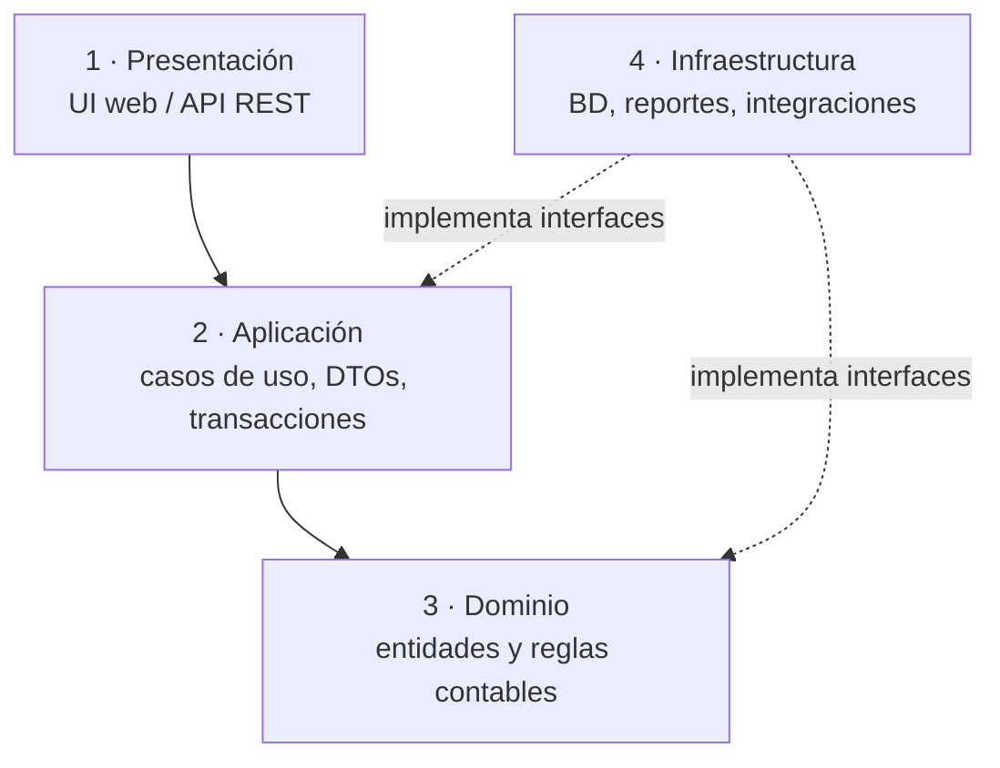

# Arquitectura del sistema

Sistema de contabilidad de costos con enfoque gerencial, basado en [[Libro de Horngren]]. Decisión de base: [[ADR-0001 Arquitectura en capas]]. Módulos del dominio: [[Modelo de dominio]].

## Vista de capas

Las flechas son dependencias de código: **todas apuntan hacia el dominio**. Infraestructura implementa las interfaces (puertos) que declaran dominio y aplicación, y se conecta en el arranque (inyección de dependencias).

## Responsabilidades por capa

### 1. Presentación
- Pantallas o endpoints: captura de órdenes de trabajo, presupuestos y reportes de variaciones.
- Valida el formato de la entrada (campos obligatorios, tipos); **no** valida reglas contables.
- Muestra las variaciones con su efecto **F/D**, como en el libro ([[Presupuesto flexible]]).

### 2. Aplicación
Un caso de uso por intención del usuario. Ejemplos:

| Caso de uso | Concepto del wiki |
|---|---|
| `CostearOrdenDeTrabajo` | [[Costeo por órdenes de trabajo]] |
| `CerrarAñoYAjustarIndirectos` | [[Costos indirectos subaplicados y sobreaplicados]] |
| `CostearPorActividades` | [[Costeo basado en actividades]] |
| `CostearProcesoDelPeriodo` | [[Costeo por procesos]] |
| `PrepararPresupuestoMaestro` | [[Presupuesto maestro]] |
| `CalcularVariaciones` | [[Variación en precio y en eficiencia]], [[Variaciones en costos indirectos]] |
| `AnalizarCVU` | [[Análisis costo-volumen-utilidad]] |
| `EvaluarDecisionFabricarOComprar` | [[Costo relevante]] |
| `AnalizarRentabilidadDelCliente` | [[Rentabilidad del cliente]] |

### 3. Dominio
- Entidades, objetos de valor y servicios de dominio, organizados en los módulos de [[Modelo de dominio]].
- Código puro: sin ORM, sin HTTP, sin fechas del sistema (el periodo contable se recibe como dato).
- Objetos de valor transversales: `Dinero`, `Cantidad`, `PeriodoContable`, `Porcentaje`, `Variacion(monto, efecto F|D)`.

### 4. Infraestructura
- Repositorios (persistencia de órdenes, presupuestos, tasas y resultados).
- Integración con la contabilidad general: **mayor general y mayores auxiliares** ([[Costeo por órdenes de trabajo]]).
- Exportación de reportes (estado de resultados por costeo variable y absorbente, reportes de variaciones).

## Estrategia de pruebas

| Capa | Tipo de prueba | Fuente de los casos |
|---|---|---|
| Dominio | Unitarias | Ejemplos y "Problema para autoestudio" del libro (p. ej., O'Shea en [[Variación en precio y en eficiencia]]) |
| Aplicación | De casos de uso con repositorios en memoria | Escenarios de cada capítulo |
| Infraestructura | De integración | BD de prueba |
| Presentación | End-to-end de los flujos principales | Pocos y críticos |

## Decisiones pendientes

- [ ] Lenguaje y framework (afecta solo a Presentación e Infraestructura).
- [ ] Motor de base de datos.
- [ ] Alcance de la primera versión (propuesta: módulos de Clasificación de costos, Costeo por órdenes y CVU).
- [ ] Monolito modular frente a servicios separados (propuesta: monolito modular; ver ADR-0001).
