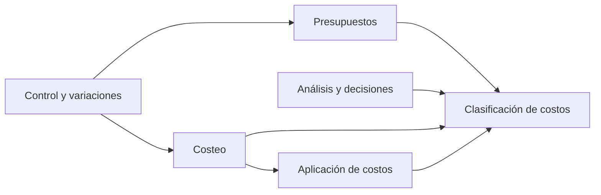

# Modelo de dominio

Módulos de la capa de dominio de [[Arquitectura del sistema]]. Cada módulo corresponde a un panorama del wiki y a capítulos de [[Libro de Horngren]].

> [!nota] Inferencia
> La división en módulos es una propuesta de diseño, no está en el libro. Los conceptos y fórmulas de cada módulo sí salen del libro y enlazan a su página del wiki.

## Mapa de módulos

Las flechas indican qué módulo usa conceptos de otro. **Clasificación de costos** es el núcleo compartido.

## Módulos

### 1. Clasificación de costos (núcleo) — cap. 2 y 10
Conceptos: [[Objeto de costo]], [[Costo directo e indirecto]], [[Costo variable y fijo]], [[Generador de costos]], [[Rango relevante]], [[Costo inventariable y costo del periodo]], [[Costo primo y costo de conversión]], [[Función de costos]].

- `ObjetoDeCosto` (producto, servicio, cliente, departamento, actividad).
- `Costo` con su clasificación: directo/indirecto **respecto de un objeto** (el mismo costo puede ser directo para uno e indirecto para otro) y variable/fijo **respecto de un generador**.
- `FuncionDeCosto(a, b, generador, rangoRelevante)`.

### 2. Costeo — cap. 4, 5, 9, 17 y 18
Panorama: [[Sistemas de costeo]].

- `OrdenDeTrabajo`, `HojaDeCostos`, `RequisicionDeMateriales`, `HojaDeTiempo` → [[Costeo por órdenes de trabajo]].
- `GrupoComunDeCostos`, `BaseDeAplicacion`, `TasaPresupuestada` → [[Costeo estimado y costeo real]].
- `AjusteDeIndirectos` (tasa ajustada, prorrateo, costo de ventas) → [[Costos indirectos subaplicados y sobreaplicados]].
- `Actividad`, `NivelDeJerarquia` → [[Costeo basado en actividades]], [[Jerarquía de costos]].
- `Proceso`, `UnidadesEquivalentes`, `MetodoDeCosteo (PromedioPonderado | PEPS)` → [[Costeo por procesos]], [[Unidades equivalentes]].
- `UnidadesDefectuosas (normales | anormales)` → [[Unidades defectuosas, reprocesamiento y desecho]].
- `PoliticaDeInventario (Variable | Absorbente | Especifico)` y `NivelDeCapacidad` → [[Costeo variable y costeo absorbente]], [[Niveles de capacidad]].

### 3. Presupuestos — cap. 6
Panorama: [[Presupuestos y control administrativo]].

- `PresupuestoMaestro` = `PresupuestoOperativo` + `PresupuestoFinanciero` → [[Presupuesto maestro]].
- `CentroDeResponsabilidad (Costos | Ingresos | Utilidades | Inversion)` → [[Contabilidad por áreas de responsabilidad]].

### 4. Control y variaciones — cap. 7 y 8
- `CostoEstandar(insumoEstandar, precioEstandar)` → [[Costo estándar]].
- `PresupuestoEstatico`, `PresupuestoFlexible` → [[Presupuesto flexible]].
- `Variacion(monto, efecto F|D)` con sus subtipos: precio, eficiencia, gastos y volumen de producción → [[Variación en precio y en eficiencia]], [[Variaciones en costos indirectos]].

### 5. Análisis y decisiones — cap. 3, 11, 12 y 13
Panorama: [[Decisiones con información de costos]].

- `AnalisisCVU` (margen de contribución, punto de equilibrio, margen de seguridad, grado de apalancamiento) → [[Análisis costo-volumen-utilidad]], [[Punto de equilibrio]], [[Margen de contribución]].
- `AlternativaDeDecision` que filtra los costos relevantes y suma el costo de oportunidad → [[Costo relevante]], [[Costo de oportunidad]], [[Costo hundido]].
- `PrecioMeta`, `CostoMeta` → [[Costo meta]], [[Fijación de precios]].

### 6. Aplicación de costos — cap. 14, 15 y 16
Panorama: [[Aplicación de costos]].

- `CriterioDeAplicacion` → [[Criterios de aplicación de costos]].
- `MetodoDepartamentosDeApoyo (Directo | Escalonado | Reciproco)` → [[Aplicación de costos de departamentos de apoyo]].
- `MetodoCostosConjuntos (ValorVentasSeparacion | VNR | PorcentajeConstanteUB | UnidadesFisicas)` → [[Productos conjuntos y subproductos]].
- `PerfilDeRentabilidadDelCliente` → [[Rentabilidad del cliente]].

## Fuera del alcance inicial

- Tablero de control balanceado y análisis de productividad (cap. 13) → [[Tablero de control balanceado]].
- Curvas de aprendizaje y regresión (cap. 10) → [[Curva de aprendizaje]].
